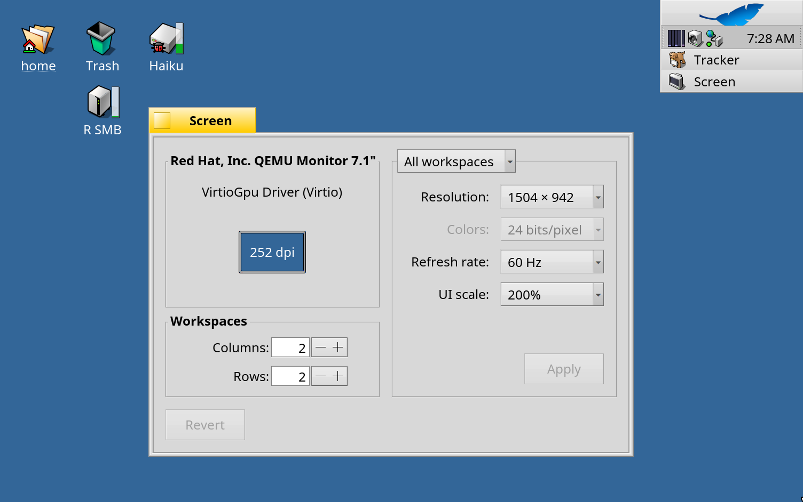

# R Retina pour RenkuOS

[English](README.md) · [한국어](README.ko.md) · [日本語](README.ja.md) · [Italiano](README.it.md) · [Français](README.fr.md)

La prise en charge HiDPI (« Retina ») pour RenkuOS sur x86_64 et arm64. La taille de toute l'interface suit l'écran et se choisit dans **Préférences > Screen > UI scale** (automatique, 100 %, 150 %, 200 %) ; les icônes du bureau gardent leur place quand elle change, et dans QEMU l'écran suit la fenêtre, net sur un Mac Retina.



## Installation

R Retina est le paquet `rretina` sur pkgman.rainygirl.com.

| RenkuOS | Commandes |
| --- | --- |
| x86_64 | `pkgman add-repo https://pkgman.rainygirl.com/x86_64`<br>`pkgman install rretina` |
| arm64 | `pkgman add-repo https://pkgman.rainygirl.com/arm64`<br>`pkgman install rretina` |

Redémarrez ensuite le système, puis choisissez l'échelle dans **Préférences > Screen > UI scale**. « Automatic » la déduit à chaque démarrage de la densité de pixels de l'écran.

Pour revenir au système d'origine, lancez `pkgman uninstall rretina` et redémarrez.

R Retina est conçu pour RenkuOS `r1~beta6_hrev60071_15_dirty` ; pkgman ne l'installe pas sur une autre version.

## Pages web

R Retina agrandit le système, mais les pages web sont dessinées par HaikuWebKit, un paquet séparé. Pour voir les pages dans WebPositive à la même échelle, installez HaikuWebKit 1.10.0-6 ou plus récent avec le correctif (arm64) :

```sh
pkgman add-repo https://pkgman.rainygirl.com/arm64-webpositive
pkgman update haikuwebkit
```

Sur x86_64, les pages restent à 100 %.

## QEMU sur un Mac Retina

Lancez QEMU avec `-display cocoa,zoom-to-fit=on -device virtio-gpu-pci` et choisissez 200 % dans Screen : Haiku suit alors la taille de la fenêtre, plein écran compris, avec un pixel par pixel physique de l'écran Retina.

## Licence

MIT

## Utilisation de l'IA

Certaines parties de R Retina ont été développées avec l'aide d'outils de programmation à base d'IA (Claude d'Anthropic). Tout le code a été relu et testé par l'auteur.
