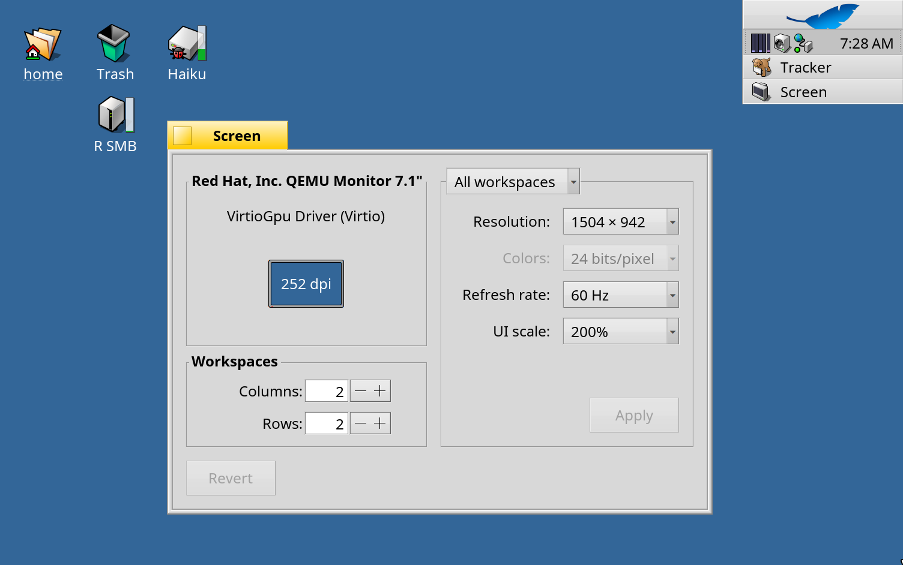

# R Retina per RenkuOS

[English](README.md) · [한국어](README.ko.md) · [日本語](README.ja.md) · [Italiano](README.it.md) · [Français](README.fr.md)

Supporto HiDPI ("Retina") per RenkuOS su x86_64 e arm64. La dimensione di tutta l'interfaccia segue lo schermo e si può scegliere in **Preferenze > Screen > UI scale** (automatica, 100%, 150%, 200%); le icone della scrivania restano al loro posto quando cambia, e dentro QEMU lo schermo segue la finestra, nitido su un Mac Retina.



## Installazione

R Retina è il pacchetto `rretina` su pkgman.rainygirl.com.

| RenkuOS | Comandi |
| --- | --- |
| x86_64 | `pkgman add-repo https://pkgman.rainygirl.com/x86_64`<br>`pkgman install rretina` |
| arm64 | `pkgman add-repo https://pkgman.rainygirl.com/arm64`<br>`pkgman install rretina` |

Dopo l'installazione riavvia il sistema, poi scegli la scala in **Preferenze > Screen > UI scale**. "Automatic" la ricava a ogni avvio dalla densità di pixel dello schermo.

Per tornare al sistema originale esegui `pkgman uninstall rretina` e riavvia.

R Retina è fatto per una versione di RenkuOS alla volta: arm64 1.0.0-11 per `r1~beta6_hrev60072_578_dirty` (l'immagine 2026.11.09-2), 1.0.0-9 per `r1~beta6_hrev60071_15_dirty`. pkgman.rainygirl.com offre quello per l'immagine attuale; pkgman non lo installa su altre versioni.

## Pagine web

R Retina ingrandisce il sistema, ma le pagine web le disegna HaikuWebKit, un pacchetto a parte. Per vedere le pagine in WebPositive alla stessa scala installa HaikuWebKit 1.10.0-6 o successivo con la patch (arm64):

```sh
pkgman add-repo https://pkgman.rainygirl.com/arm64-webpositive
pkgman update haikuwebkit
```

Su x86_64 le pagine restano al 100%.

## QEMU su un Mac Retina

Avvia QEMU con `-display cocoa,zoom-to-fit=on -device virtio-gpu-pci` e scegli 200% in Screen: Haiku segue la dimensione della finestra, schermo intero compreso, con un pixel per ogni pixel fisico del display Retina.

## Licenza

MIT

## Uso dell'IA

Parti di R Retina sono state sviluppate con l'aiuto di strumenti di programmazione basati sull'IA (Claude di Anthropic). Tutto il codice è stato rivisto e testato dall'autore.
