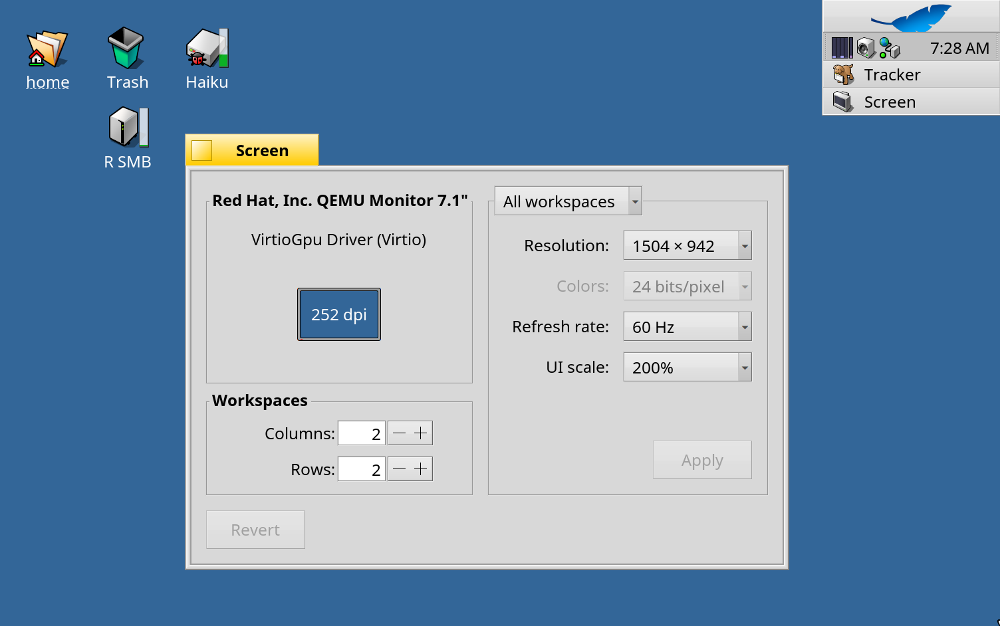

# RenkuOS 用 R Retina

[English](README.md) · [한국어](README.ko.md) · [日本語](README.ja.md) · [Italiano](README.it.md) · [Français](README.fr.md)

x86_64 と arm64 の RenkuOS 向けの HiDPI (Retina) 対応です。UI 全体の大きさがディスプレイに合わせて決まり、**環境設定 > Screen > UI scale** で選ぶこともできます (自動、100%、150%、200%)。倍率が変わってもデスクトップのアイコンは位置を保ち、QEMU の中では画面がウインドウの大きさに追従して、Retina の Mac でくっきり表示されます。



## インストール

R Retina は pkgman.rainygirl.com のパッケージ `rretina` です。

| RenkuOS | コマンド |
| --- | --- |
| x86_64 | `pkgman add-repo https://pkgman.rainygirl.com/x86_64`<br>`pkgman install rretina` |
| arm64 | `pkgman add-repo https://pkgman.rainygirl.com/arm64`<br>`pkgman install rretina` |

インストール後に再起動し、**環境設定 > Screen > UI scale** で倍率を選びます。「Automatic」にすると、起動のたびにディスプレイの画素密度から決まります。

元のシステムに戻すには `pkgman uninstall rretina` を実行して再起動します。

R Retina は RenkuOS のバージョンごとに作られています。arm64 の 1.0.0-11 は `r1~beta6_hrev60072_578_dirty`（2026.11.09-2 イメージ）用、1.0.0-9 は `r1~beta6_hrev60071_15_dirty` 用です。pkgman が合うほうを選び、ほかのバージョンにはインストールしません。

## Web ページ

R Retina はシステムを拡大しますが、Web ページは別パッケージの HaikuWebKit が描きます。WebPositive でも同じ倍率で表示するには、パッチを当てた HaikuWebKit 1.10.0-6 以降 (arm64) をインストールします。

```sh
pkgman add-repo https://pkgman.rainygirl.com/arm64-webpositive
pkgman update haikuwebkit
```

x86_64 では Web ページはまだ 100% で表示されます。

## Retina の Mac での QEMU

QEMU を `-display cocoa,zoom-to-fit=on -device virtio-gpu-pci` で起動し、Screen で 200% を選びます。Haiku はフルスクリーンを含めてウインドウの大きさに追従し、Retina ディスプレイの物理ピクセル 1 つにピクセル 1 つで描画します。

## ライセンス

MIT

## AI の利用について

R Retina の一部は AI コーディングツール (Anthropic の Claude) の支援を受けて開発されました。すべてのコードは作者がレビューし、テストしています。
