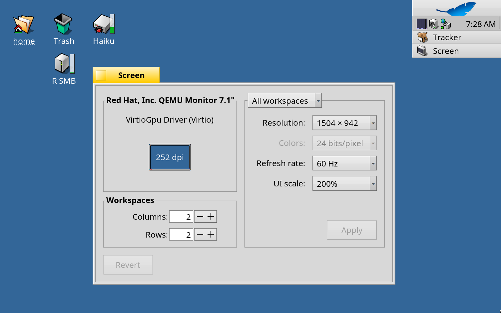

# RenkuOS용 R Retina

[English](README.md) · [한국어](README.ko.md) · [日本語](README.ja.md) · [Italiano](README.it.md) · [Français](README.fr.md)

x86_64와 arm64 RenkuOS를 위한 HiDPI(레티나) 지원입니다. 화면에 맞춰 UI 전체의 크기가 정해지고, **환경 설정 > Screen > UI scale**에서 직접 고를 수도 있습니다(자동, 100%, 150%, 200%). 배율이 바뀌어도 바탕화면 아이콘은 제자리를 지키고, QEMU 안에서는 창 크기를 따라 해상도가 바뀌어 레티나 맥에서 선명하게 보입니다.



## 설치

R Retina는 pkgman.rainygirl.com의 `rretina` 패키지입니다.

| RenkuOS | 명령 |
| --- | --- |
| x86_64 | `pkgman add-repo https://pkgman.rainygirl.com/x86_64`<br>`pkgman install rretina` |
| arm64 | `pkgman add-repo https://pkgman.rainygirl.com/arm64`<br>`pkgman install rretina` |

설치한 뒤 재부팅하고, **환경 설정 > Screen > UI scale**에서 배율을 고릅니다. "Automatic"을 고르면 부팅할 때마다 화면의 픽셀 밀도에 맞춰 정합니다.

원래 시스템으로 돌아가려면 `pkgman uninstall rretina`를 실행하고 재부팅합니다.

R Retina는 RenkuOS 버전마다 따로 만들어집니다: arm64 1.0.0-11은 `r1~beta6_hrev60072_578_dirty`(2026.11.09-2 이미지)용, 1.0.0-9는 `r1~beta6_hrev60071_15_dirty`용입니다. pkgman이 맞는 쪽을 고르고, 다른 버전에는 설치하지 않습니다.

## 웹 페이지

R Retina는 시스템의 크기를 키우지만, 웹 페이지는 별도 패키지인 HaikuWebKit이 그립니다. WebPositive에서도 같은 배율로 보려면 패치된 HaikuWebKit 1.10.0-6 이상(arm64)을 설치합니다.

```sh
pkgman add-repo https://pkgman.rainygirl.com/arm64-webpositive
pkgman update haikuwebkit
```

x86_64에서는 아직 웹 페이지가 100%로 보입니다.

## 레티나 맥의 QEMU

QEMU를 `-display cocoa,zoom-to-fit=on -device virtio-gpu-pci` 옵션으로 실행하고 Screen에서 200%를 고릅니다. 그러면 Haiku가 전체 화면을 포함해 창 크기를 따라가며, 레티나 화면의 실제 픽셀 하나에 픽셀 하나씩 그립니다.

## 라이선스

MIT

## AI 사용 고지

R Retina의 일부는 AI 코딩 도구(Anthropic Claude)의 도움을 받아 개발했습니다. 모든 코드는 작성자가 검토하고 테스트했습니다.
