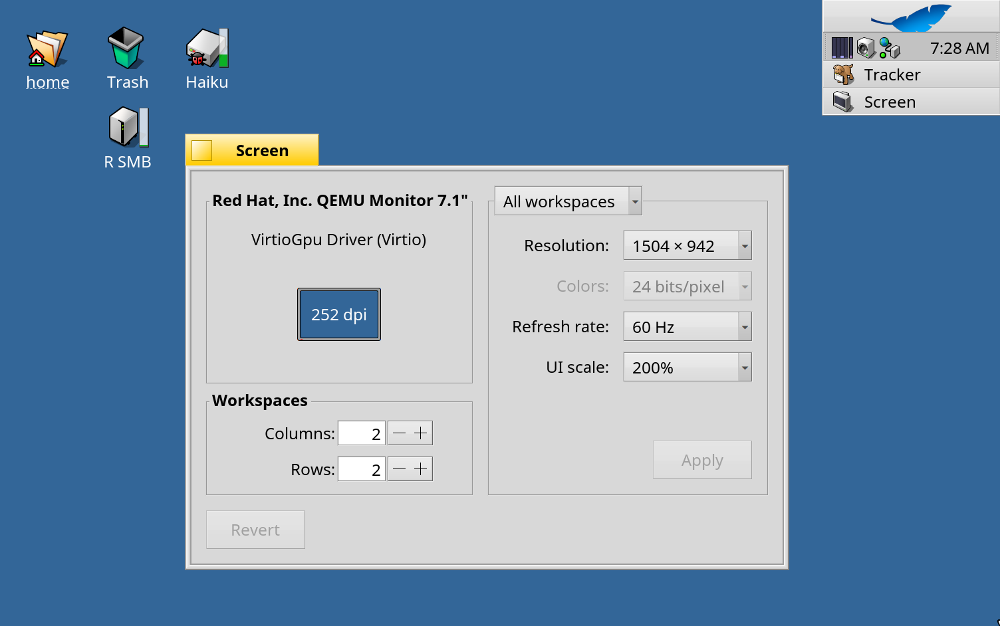

# R Retina for RenkuOS

[English](README.md) · [한국어](README.ko.md) · [日本語](README.ja.md) · [Italiano](README.it.md) · [Français](README.fr.md)

HiDPI ("Retina") support for RenkuOS on x86_64 and arm64. The size of the whole user interface follows your display, you can choose it in **Preferences > Screen > UI scale** (Automatic, 100%, 150%, 200%), desktop icons keep their places when it changes, and inside QEMU the screen follows the window - sharp on a Retina Mac.



## Installation

R Retina is the package `rretina` on pkgman.rainygirl.com.

| RenkuOS | Commands |
| --- | --- |
| x86_64 | `pkgman add-repo https://pkgman.rainygirl.com/x86_64`<br>`pkgman install rretina` |
| arm64 | `pkgman add-repo https://pkgman.rainygirl.com/arm64`<br>`pkgman install rretina` |

Restart the system afterwards, then choose the scale in **Preferences > Screen > UI scale**. "Automatic" picks it from your display's pixel density at every start.

To go back to the stock system, run `pkgman uninstall rretina` and restart.

R Retina is built for one RenkuOS version at a time: arm64 1.0.0-11 for `r1~beta6_hrev60072_578_dirty` (the 2026.11.09-2 image), 1.0.0-9 for `r1~beta6_hrev60071_15_dirty`. pkgman picks the one that matches and installs none on other versions.

## Web pages

R Retina scales the system, but web pages are drawn by HaikuWebKit, a separate package. To see pages in WebPositive at the same scale, install the patched HaikuWebKit 1.10.0-6 or later (arm64):

```sh
pkgman add-repo https://pkgman.rainygirl.com/arm64-webpositive
pkgman update haikuwebkit
```

On x86_64, pages are still shown at 100%.

## QEMU on a Retina Mac

Start QEMU with `-display cocoa,zoom-to-fit=on -device virtio-gpu-pci` and choose 200% in Screen. Haiku then follows the window size - including full screen - with one pixel per physical pixel of the Retina display.

## License

MIT

## AI disclosure

Parts of R Retina were developed with the assistance of AI coding tools (Anthropic's Claude). All code has been reviewed and tested by the author.
